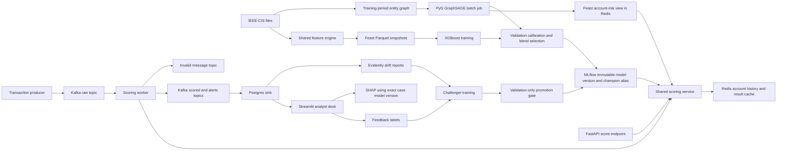

# Architecture and guarantees

## Data and time

The pseudo-account key combines the existing card, address and estimated account
start date. It is an approximation, not a verified identity. Model features never
include target labels, transaction IDs or account IDs.

History uses `[event_time-window, event_time)`. All same-time observations are
held pending until time advances. The incremental engine's serialized state is
stored in Redis. It survives a scorer restart; deployment persistence requires
the Redis data volume or Kubernetes PVC.

The graph is heterogeneous: account nodes connect to card, device, email and
address identifiers. Identifiers shared by more than 20 training accounts are
excluded as hubs. Two GraphSAGE layers pass information through these links.
Message passing means a node combines its own features with the features of its
neighbors; it can learn patterns shared across linked accounts. Uniform bounded
neighbor sampling limits the work without requiring optional native PyG samplers.
The typed graph is converted to a shared-weight GraphSAGE representation; this
prototype does not learn a separate convolution for each identifier type.

Edges, account aggregates and graph training labels all end at the training
cutoff. Validation/test accounts are looked up against that frozen graph; unseen
accounts receive the training fraud-rate prior. The API additionally rejects
graph snapshots at or after the transaction's event time.

## Calibration and selection

The first half of validation fits logistic calibration for XGBoost and GNN scores.
Calibration maps model scores toward observed fraud frequencies. The second half
chooses the blend from a fixed weight grid and the top-1% alert threshold. The
test period is used only for final evaluation, never for selecting weights.

The measured graph experiment selected XGBoost weight 1.0: GNN predictions made
validation ranking worse. Graph links remain useful analyst evidence; they do
not automatically establish fraud. The saved ablation report records this result.

## Delivery and retries

1. Raw Kafka messages are keyed by account and currently use one partition.
2. Redis WATCH atomically checks the account state and transaction result cache.
3. A valid transaction updates history and caches its result in the same Redis
   transaction. Failed validation/inference never commits history.
4. Repeated TransactionID plus identical payload returns the original prediction.
   Reusing an ID with different data is rejected. Per-account late events are
   rejected rather than silently calculating incorrect history.
5. The worker publishes results and commits consumed offsets in a Kafka
   transaction. After a crash, Redis may already contain the score: replay reads
   that cached result, then safely retries the Kafka transaction.
6. The Postgres sink commits its database transaction before acknowledging Kafka.
   Primary keys make replayed sink messages idempotent.

This combines Redis idempotency, Kafka transactional output and an idempotent
sink; it is not a distributed transaction across all three systems. The one
worker/partition development topology is deliberate. Keep that constraint until
partition ownership, rebalancing and multi-worker ordering are explicitly tested.
Operational/load tests replay historical training-period rows to test delivery and
speed, not to estimate prediction accuracy. Accuracy comes from the separate,
time-held-out test predictions. A cold live account has only the history observed
by this deployment; pre-existing history must be replayed before serving it.

`POST /score` shares the scoring logic but returns its result directly; it does
not publish a Kafka message or create a dashboard case. Use the producer/Kafka
path for the full analyst workflow. API clients must also preserve account order.

## Explanations and feedback

SHAP explanations are computed when an analyst opens a case, not in the scoring
hot path. The exact immutable model version attached to that case is loaded.
Reasons are signed XGBoost log-odds contributions, not additive contributions to
the final calibrated probability.

Alerts and a deterministic 1% random audit sample enter the queue. Case status,
notes and binary labels persist in Postgres. Retraining applies only eligible
feedback for existing training-period IDs; demo records and validation/test IDs
are excluded. This demonstration corrects training labels; it does not yet advance
the training time window or retrain from unlabeled shifted traffic.

Evidently monitors four numeric columns. A normalized Wasserstein distance above
0.1 marks a column as shifted; a drifted share of at least 0.25 triggers a
challenger when monitoring is run with `--retrain`. A data fingerprint prevents
repeated jobs for the same window. The 4 GiB Minikube node schedules report-only
monitoring: a November 1 CPU training attempt exhausted its memory and was
suspended. Full challenger training must run separately from this interactive
deployment in a configured host/GPU environment or on adequately sized resources.
Promotion requires validation PR-AUC improvement greater than 0.001. A Redis
promotion lock and incumbent-version check prevent competing jobs from silently
overwriting a newer champion. Scorers check the champion alias every 30 seconds
when new transactions arrive; cached duplicate results keep their original model.
The daily graph Job performs inference with the evaluated checkpoint and verifies
its scores against that snapshot before rematerializing them. It never resets the
champion alias to an older XGBoost bundle. The demo graph remains frozen at the
training cutoff; advancing it requires a new time-based evaluation.

## Deployment and operational limits

Compose uses host Redis port 6380 and Postgres port 5433 to avoid unrelated Windows
services. Containers use their normal internal ports. Minikube uses a separate
database, Redis, model registry and persistent volumes in namespace `fraud`.
Model/feature artifacts are seeded from the already measured local run.

The local demo binds exposed app ports to localhost. It has no production user
authentication, TLS, high availability, backup policy or distributed tracing.
Kubernetes probes and resource limits improve operation but do not make this
single-node student deployment production-ready. Raw IEEE-CIS data must be
downloaded separately; it is never committed to Git.
Kafka and ZooKeeper use ephemeral storage in the Kubernetes demonstration. Their
queues/metadata must be recreated and source transactions replayed after broker
pod replacement; durable broker volumes and replication are not included here.
