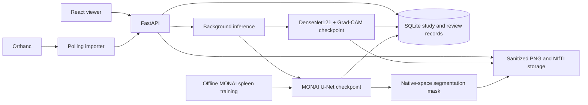

# Architecture and API

The MONAI segmenter is connected through NIfTI and complete classic CT DICOM ZIP inputs. Orthanc import waits for stable, complete series with a known matching count. Model-enabled CPU containers and authenticated upload-to-review paths have been exercised; measured evidence is in `docs/RESULTS.md`.

| Endpoint | Behavior |
|---|---|
| GET `/api/health` | Health, checkpoint configuration presence, local-only auth status |
| GET `/api/studies` | Studies with results and review history |
| POST `/api/studies` | Multipart `file`; PNG/JPEG/DX/CR; 20 MB, 16 million pixels |
| GET `/api/studies/{id}` | Full study detail |
| GET `/api/studies/{id}/files/{filename}` | Allowlisted sanitized image or heatmap |
| POST `/api/demo` | Create explicitly synthetic workflow fixture |
| POST `/api/studies/{id}/retry` | Retry failed/awaiting-model study after configuration |
| POST `/api/studies/{id}/reviews` | reviewer, decision (`approve`/`reject`), comment, model_version |
| POST `/api/volumes` | Gzip-compressed abdominal CT NIfTI, bounded decoding and geometry checks |
| POST `/api/ct-series` | Complete single-frame CT ZIP with manifest.json declaring expected_slices; validate geometry and reconstruct volume |
| POST `/api/auth/login` | Username/password sign-in; rate-limited; sets HTTP-only session cookie |
| GET `/api/auth/session` | Current account and role |
| POST `/api/auth/logout` | Revoke the current session |
| GET `/api/studies/{id}/slices/{index}` | Axial CT slice; `overlay=true` returns the aligned predicted mask |

Runtime files live under `data/runtime`. A UUID directory contains either a sanitized PNG and explanation overlays, or a canonical CT volume and segmentation mask. The database holds SHA-256 input digest, timestamp, state, serialized prediction and immutable review events. Original source filenames are not persisted by the API. IDs are looked up in the database before paths are used; filenames are allowlisted.

State flow: upload → awaiting_model OR processing → ready/failed. Failed or waiting studies can retry. A process restart marks processing studies failed. Reviews require ready status and matching model version. All timestamps are UTC; the viewer formats local time.

Account authentication is enabled by the local launcher and model-enabled Compose override. Passwords use salted PBKDF2-SHA256; opaque eight-hour sessions use HTTP-only SameSite cookies. Viewer accounts cannot mutate studies; reviewer/admin accounts can upload and review. The server records the authenticated account name, ignoring a spoofed submitted reviewer name. Origin checks protect browser writes; sign-in attempts are rate-limited. Cookies require COOKIE_SECURE=true and HTTPS for remote use. Accounts do not verify medical qualifications.

Remaining operational limits: no queue capacity limit, pagination, durable job broker, deletion/retention UI or production audit signing. Enhanced multi-frame CT and gantry tilt are rejected; unknown series completeness is deferred. Inference is serialized within one process. Browser/API are same-origin via Vite or Nginx. Ports bind locally. SQLite suits this prototype; concurrent shared deployment requires further operational and security review.
