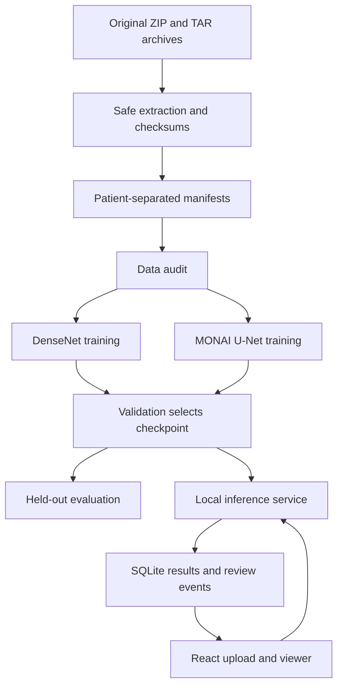

# Lumen: complete code and workflow guide

This guide explains how the application is built and how to modify it. The accompanying Excel workbook contains the full source snapshot, an indexed function list, settings and space for your proposed changes. Editing the spreadsheet does not execute code or update project files automatically. Make application changes in the original source files and rerun the relevant tests.

## 1. Overall design

The application has three main parts. React runs in your browser and provides controls for uploading and reviewing scans. FastAPI runs locally in Python and stores studies, predictions and review events. PyTorch and MONAI train models offline, then supply inference functions to the API. Training does not happen when a reviewer uploads a scan.

The two tasks stay separate: DenseNet121 predicts five chest findings from a frontal radiograph; a 3D U-Net segments spleen anatomy in abdominal CT. These models do not handle arbitrary MRI scans or general diagnosis. The interface consistently states education-only use.

## 2. Folder responsibilities

| Folder | Contents | Can you edit it? |
|---|---|---|
| `data/raw/chexpert` | Original ZIP and extracted radiographs/CSVs | Preserve the originals |
| `data/raw/spleen` | Original TAR and extracted CT/mask volumes | Preserve the originals |
| `data/splits` | Reproducible manifests defining partition membership | Regenerate before experiments, never silently after test evaluation |
| `data/runtime` | Uploaded sanitized previews/volumes, outputs and SQLite database | Generated application data, not source code |
| `data/predictions` | Native-space masks generated during offline evaluation | Generated results |
| `models` | Best and latest model checkpoints, training histories and run configuration | Keep checkpoints matched to code and data version |
| `ml` | Preparation, architectures, training, inference and evaluation Python | Main place to modify ML behavior |
| `backend` | API, validation, storage and Orthanc import | Main place to modify service behavior |
| `frontend/src` | React interface and styling | Main place to modify user experience |
| `tests` | Regression checks using synthetic data | Extend when behavior changes |
| `reports` | Actual verification and evaluation evidence | Generated results must reflect real runs |
| `docs` | Architecture, limits, instructions and this explanation | Update alongside implementation |

## 3. Extracting and preparing data

`ml/extract_data.py` calculates an archive SHA-256 hash, checks disk capacity, and rejects paths that could escape the destination. TAR links and special entries are rejected. Apple resource-fork entries beginning with `._` are skipped. Each regular file is first written to a temporary file, then renamed. A completion marker is written only after extraction completes. Original archives are retained.

`ml/prepare_data.py` handles the real CheXpert archive layout: the CSV can refer to `CheXpert-v1.0-small/train/...`, while the extracted archive stores `train/...` directly. It resolves either supported layout inside the selected dataset root. It selects frontal views, normalizes labels such as `1.0` to `1`, and preserves missing and uncertain labels.

The splitter sorts unique patient IDs, shuffles with seed 42, and allocates approximately 70% to train, 15% to validation and the remainder to test. Every image from a patient inherits the same split. For spleen, a labeled case is treated as a patient. Source `imagesTs` lacks the masks needed for local quantitative evaluation, so it is not used as the internal labeled test set.

`ml/development_subset.py` creates a smaller initial cohort within those existing partitions. It does not move patients between splits. This is useful for checking local hardware and end-to-end learning; its results must be labeled as development-cohort results.

`ml/audit_data.py` checks patient overlap, counts known/missing/uncertain labels, verifies a seeded image sample, and checks all paired CT image/mask shapes and affine matrices. A sampled X-ray audit is not a claim that every pixel file was decoded.

## 4. X-ray architecture and preprocessing

`ml/classifier.py` is shared by training and serving. It builds DenseNet121 and replaces its classifier with five outputs in a fixed order: Atelectasis, Cardiomegaly, Consolidation, Edema, Pleural Effusion. A sigmoid maps each logit independently into a score, because findings can coexist.

Images are converted to RGB, resized to 224 × 224, converted to tensors and normalized with the ImageNet channel means and standard deviations. Training additionally applies a small random rotation. Validation, test and serving omit augmentation. Changing preprocessing only in one path creates an inconsistent system.

Transfer learning starts from general-image weights. Training with `--freeze-backbone` updates only the final classification layer and keeps feature extraction in evaluation mode. Fine-tuning without that flag updates the full network and uses more compute. The checkpoint records which mode was used.

## 5. X-ray training

`Images` loads each image and constructs two label tensors: targets and a known-label mask. Missing labels and -1 uncertainty do not contribute to the loss. They are not silently converted into negative findings. The code calculates binary cross-entropy for each output, then averages only known-label entries.

`read_manifest` rejects patient overlap and invalid labels before training starts. AdamW updates trainable parameters. After each epoch, the validation loader computes per-finding AUROC and average precision where both positive and negative labels exist. Mean available validation AUROC selects `best.pt`.

`last.pt` saves model, optimizer, completed epoch, best score, history, manifest fingerprint and PyTorch random states. `--resume` checks that the manifest and freeze mode match. Saving a resumable checkpoint is different from saving only inference weights. A process interruption during an epoch resumes from the previous completed epoch.

## 6. X-ray evaluation and explanations

`ml/evaluate_classifier.py` verifies checkpoint label order and manifest hash. It uses validation scores to choose one threshold per finding by maximum Youden J. It then reports held-out test AUROC, average precision, Brier score, sensitivity, specificity and confusion counts. Labels lacking enough known positives/negatives are explicitly marked unavailable. No calibration training is implied by reporting a Brier score.

`ml/inference.py` loads a checkpoint, uses shared preprocessing and generates five sigmoid scores. For Grad-CAM it differentiates one class logit with respect to the final convolutional feature tensor. Spatially averaged gradients weight the features; their positive weighted sum becomes a heatmap. Each overlay is resized to the original image dimensions and stored as RGBA PNG.

Grad-CAM is coarse model influence, not a lesion boundary or proof of a correct diagnosis. JPEG-trained models also require explicit evaluation on windowed DICOM inputs; matching dimensions alone does not eliminate acquisition differences.

## 7. CT training and geometry

`ml/segmentation.py` owns the shared 3D U-Net architecture and preprocessing. The network has channels 16, 32, 64, 128 and 256, two output classes and residual units. CT and masks are oriented RAS and resampled to 1.5 × 1.5 × 2 mm. CT intensities are clipped to -57 through 164 and scaled to 0–1. Masks use nearest-neighbor interpolation.

`ml/train_segmentation.py` pads small volumes, samples foreground/background 64-cube patches and flips images and masks together. Dice plus cross-entropy supervises training. Validation uses sliding-window inference over full transformed volumes, with CPU output accumulation to bound GPU memory. The best mean validation Dice selects `best.pt`.

Segmentation resume restores model and optimizer state, but random augmentation restarts from the configured seed. It is a useful continuation, not a bit-identical interrupted-run replay. This limitation is recorded in run metadata.

`segment` inverts the spatial preprocessing and writes the binary prediction using the source affine and dimensions. `ml/evaluate_segmentation.py` compares that native-space mask against the paired ground truth, checks affine/shape agreement and records per-case Dice and runtime. These native-space metrics differ from training's resampled validation metrics and should be labeled accordingly.

## 8. Backend data flow

`backend/app.py` creates the FastAPI application and the SQLite schema. A context manager opens each database transaction, enables foreign keys, commits or rolls back, and closes the connection. Startup adds new CT metadata columns to older databases and marks interrupted processing jobs failed so they can be retried.

Image uploads are bounded at 20 MB and 16 million pixels. DX/CR DICOM inputs must be single-frame monochrome images. Modality and VOI transformations produce a display image; MONOCHROME1 is inverted. The API stores a sanitized PNG with an opaque display name instead of the source filename. Burned-in identifying pixels are not automatically removed.

CT uploads accept gzip-compressed NIfTI, with compressed-byte, decompressed-byte and voxel-count limits. `backend/volume_io.py` validates 3D geometry and finite pixels, strips free-text header metadata and stores canonical RAS data. CT slices and mask overlays apply exactly the same display transformation and account for in-plane voxel spacing.

The raw input SHA-256 supports duplicate detection. The API creates an awaiting-model state when no checkpoint exists. Otherwise it schedules background inference. A single inference lock serializes model execution within one process. Successful results record model fingerprints; failures are logged and become retryable states. There is no durable external task queue yet.

## 9. Review history

A review requires a completed prediction and a matching model version. It stores the supplied reviewer name, UTC timestamp, decision, comment and prediction version. Approve followed by reject creates two events; it does not erase the first. SQL triggers reject ordinary updates and deletes from the audit table.

With account authentication enabled, the server records the signed-in account and ignores a spoofed reviewer name. The legacy explicit unauthenticated mode retains self-declared names for isolated tests. Account identity does not verify medical qualifications. A database file owner can still tamper outside normal API operations; this remains an educational audit trail rather than production tamper evidence.

## 10. React viewer

`frontend/src/main.tsx` defines API response types and component state. The `api` helper turns failures into readable errors and requests sign-in on401. `refresh` polls the study list. `choose` resets finding and slice controls. `upload` routes `.nii.gz` to volume ingestion, `.zip` to complete CT-series ingestion and other formats to radiograph ingestion. Signed-in reviewer names are read-only, and viewer accounts have write controls disabled.

The original image and transparent overlay share one canvas using identical dimensions. CT uses a slice slider; radiographs use finding buttons and scores. Overlay visibility and opacity are display controls, not changes to predictions. The review form sends the current model version and refreshes the audit history after saving.

`frontend/src/style.css` defines layout, spacing, responsive breakpoints, error states and visible keyboard focus. Source is formatted for reading rather than compressed into long lines. Modify this file for visual design and main.tsx for behavior.

## 11. Orthanc, Docker and DVC

`backend/orthanc_import.py` imports unseen radiographs and complete CT series. CT processing requires IsStable, Status=Complete and a known expected instance count matching the received instances. Stable alone is insufficient. Individual downloads and total series bytes are bounded. Persisted state tracks imported or unsupported resources; temporary HTTP failures retry. The service account signs in and refreshes its session before expiry.

Docker Compose describes API, Nginx viewer, Orthanc and importer with loopback-bound ports. The lightweight image supports data/review/demo. `compose.ml.yaml` enables a tested CPU inference image with pinned PyTorch/torchvision/MONAI versions, read-only active checkpoint/account mounts and a separate importer account. Training stays in the native NVIDIA environment. `LUMEN_DATA_DIR=/app/data/verification` isolates container tests from normal uploaded studies.

`dvc.yaml` declares full-data training stages and their dependencies. The stage file alone does not initialize a repository, upload data or prove reproducibility. Source datasets, split manifests, dependency versions and checkpoints must be versioned together before a reproducibility claim.

Local Git and DVC are initialized. Original archives and split manifests are now cached locally, and a separate manifest recovery through `dvc get` reproduced its SHA-256 exactly. Pointer files alone do not contain the data; preserve the archives/cache and arrange authorized backup for off-machine recovery. No remote was configured or uploaded. The measured experiments used direct commands rather than completed `dvc repro` stages.

## 12. How to change the code safely

1. Find the relevant file/function in the workbook. Write your intended change in its yellow notes column if useful.
2. Change the original source file. Keep original data and evaluation partitions intact.
3. Run focused tests. API/data changes need pytest; UI changes need TypeScript/Vite build and browser inspection; preprocessing changes need geometry and model checks.
4. If training behavior changes, use a new output directory and record the manifest, settings and environment. Do not overwrite an evaluated checkpoint without preserving its evidence.
5. Update HANDOFF, RESULTS and the model card. Rebuild the spreadsheet when you need a current source snapshot.

The project is complete only when both models have adequate measured results, integrations are verified, limits are documented, and the demo/presentation/reflection are prepared. A passing software test suite does not establish medical performance.

## 13. Reading the workbook and source archive

Start with **File guide** to understand each file's responsibility, then **Functions** to locate Python functions/classes and React functions/types by line number. **Settings** lists the controls that change behavior; **Tests** maps regression coverage. **Source code** contains the actual source text, not pseudocode. Filter its File column to read one component. Lines over 180 characters are stored as consecutively numbered chunks: join those chunks without inserting characters to reconstruct the original line. Blank rows of source text represent actual blank source lines.

The workbook is a review snapshot. Yellow cells hold your proposed changes; they do not execute code or edit the application. Source/config files have SHA-256 hashes for comparison. Generated dependency lockfiles are supplied in the source ZIP rather than expanded into spreadsheet rows. Medical images, label rows, installed dependencies, model binaries, runtime databases and credentials are deliberately excluded.

The ZIP preserves the project folder layout and includes documentation, tests, dependency locks, DVC pointers and the untouched original guidance files. It does not contain the `.git` history. The local checkout remains the working source of truth.

## 14. Reproducing the verified development workflow

Use the project's `.venv-ml` Python for all ML commands. Prepare or change splits only before a new experiment, preserving existing patient partition membership once test results are examined. Current files already exist; extraction and manifest creation do not need to be repeated for routine use.

1. Verify archives and extracted data with `ml.extract_data` and `ml.audit_data` when acquiring or moving datasets.
2. Train the classifier using `ml.train_classifier`; output records include the manifest fingerprint, label order, validation history, best checkpoint and resumable last checkpoint.
3. Train the CT model with `ml.train_segmentation`. Full-volume validation is slower than individual training patches. On this laptop, avoid simultaneous GPU serving and training, and avoid large in-memory CT caches.
4. Freeze a checkpoint using validation only. `ml.evaluate_classifier` chooses thresholds on validation and scores the held-out labeled subset. `ml.evaluate_segmentation` restores native geometry and measures per-case Dice.
5. Run `python -m tools.integration_check` through `.venv-ml` to execute real checkpoint upload, inference, overlay and review paths in isolated temporary storage. The test records explicit software-test rejections, not human medical approval.
6. Launch `scripts/start-local.ps1` and the frontend development server. Review a permitted de-identified input or the clearly marked synthetic demo.
7. Run pytest and the frontend production build after code changes. Update the evidence documents, regenerate the report/workbook and preserve the evaluated checkpoint before further training.

The `test_evaluated: false` field in training `run.json` means the training loop itself did not evaluate test data. Separate evaluation JSON files are the authority on subsequent held-out evaluation. Segmentation history elapsed times restart at each resumed process; do not treat the last row as total uninterrupted training time.

## 15. Complete DICOM CT reconstruction

`backend/dicom_series.py` reads a ZIP in memory; it never extracts user-named files to disk. `manifest.json` must declare expected_slices, and the DICOM count must match. Bounds apply to compressed bytes, expanded bytes, voxel count and slice count. Only classic single-frame CT with consistent study, series and coordinate-frame identities is supported.

The first ImageOrientationPatient triplet points along increasing column indices; the second points along increasing row indices. Their cross product defines the slice normal. ImagePositionPatient projected onto that normal determines slice order. The assembler validates orthonormal directions, consistent in-plane spacing, evenly spaced positions and absence of in-plane displacement. It applies each slice's rescale slope/intercept to recover intensities and converts DICOM LPS coordinates into a NIfTI RAS affine. Source metadata is discarded. Missing middle slices, duplicate positions, mixed series and gantry displacement fail explicitly. A declared expected count is necessary to detect an otherwise regular truncated stack. Oblique acquisitions retain their geometry; the viewer is an acquired-slice display, not a full multiplanar reconstruction tool.

Geometry references: [DICOM Image Plane Module](https://dicom.nema.org/medical/dicom/2023d/output/chtml/part03/sect_C.7.6.2.html), [Orthanc REST API](https://orthanc.uclouvain.be/api/).

## 16. Accounts and sessions

`backend/auth.py` owns password verification, session checks, roles, origin checks and rate limiting. A private JSON file stores salted password hashes, never plaintext passwords. `tools.create_local_account` generates the owner account and saves initial credentials in ignored local storage; `tools.setup_inference` creates a separate importer account. No secret is embedded in the source package.

Successful sign-in creates a random token; the server stores its hash and expiry while the browser receives an HTTP-only SameSite=Strict cookie. Logout revokes the token. Restarting the single backend process invalidates existing sessions. Viewer accounts can read; reviewer/admin accounts can mutate studies and append reviews. Actual reviewer identity comes from the session. Production remote use needs HTTPS, secure cookies, explicit allowed origins, account administration and further security assessment.

## 17. Improved experiments and evaluation

`ml.improved_cohort` freezes the larger X-ray experiment while excluding all baseline test patients from the new test cohort. It includes known negative training examples for rare findings; validation/test are naturally sampled within their original partitions. `--balance-known` derives positive loss weights from training labels only. `ml.select_classifier` compares the baseline and candidate on the same new validation cohort, avoiding test-based checkpoint selection.

`ml.strong_evaluation` fits positive-slope Platt calibration using validation labels only when both classes have at least20 known examples. It reports raw/calibrated Brier score and ten-bin calibration error, AUROC, average precision, threshold confusion counts, patient-bootstrap AUROC intervals and recorded-sex/age subgroup counts. Unsupported subgroup AUROCs remain unavailable. Results are conditional on known labels, not the whole population. `ml.explanation_check` compares score changes after occluding the hottest20% of Grad-CAM pixels versus a seeded random20% in known-positive validation examples; this descriptive check has distribution-shift limits and is not ground-truth localization validation.

CT experiments use a private on-disk cache of deterministic preprocessing, reducing repeated resampling without caching the entire dataset in RAM. A warm start begins a new experiment with fresh optimizer/history; resume restores an existing experiment. Patch size64or96 is stored with checkpoints and read by serving. Evaluation restores native geometry and reports per-case overlap, precision, recall, relative volume error and case-bootstrap uncertainty. The CT test cases were examined during the baseline, so the improved CT result is development re-evaluation.

`tools.promote_models` checks evaluated checkpoint fingerprints, attaches validation-derived calibration coefficients and atomically activates selected checkpoint copies. Original evaluated sources remain preserved. Application model versions include the full checkpoint contents, including calibration metadata. Active model paths are `models/active/classifier.pt` and `models/active/spleen.pt`.
